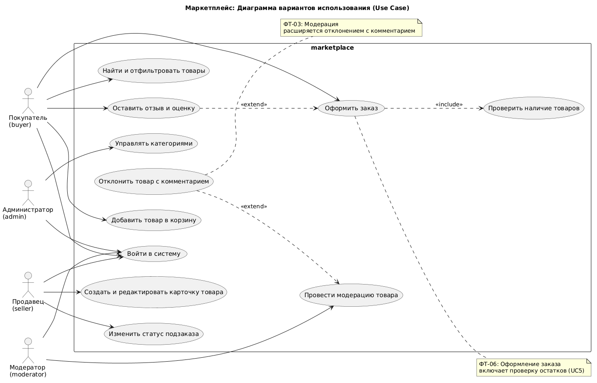
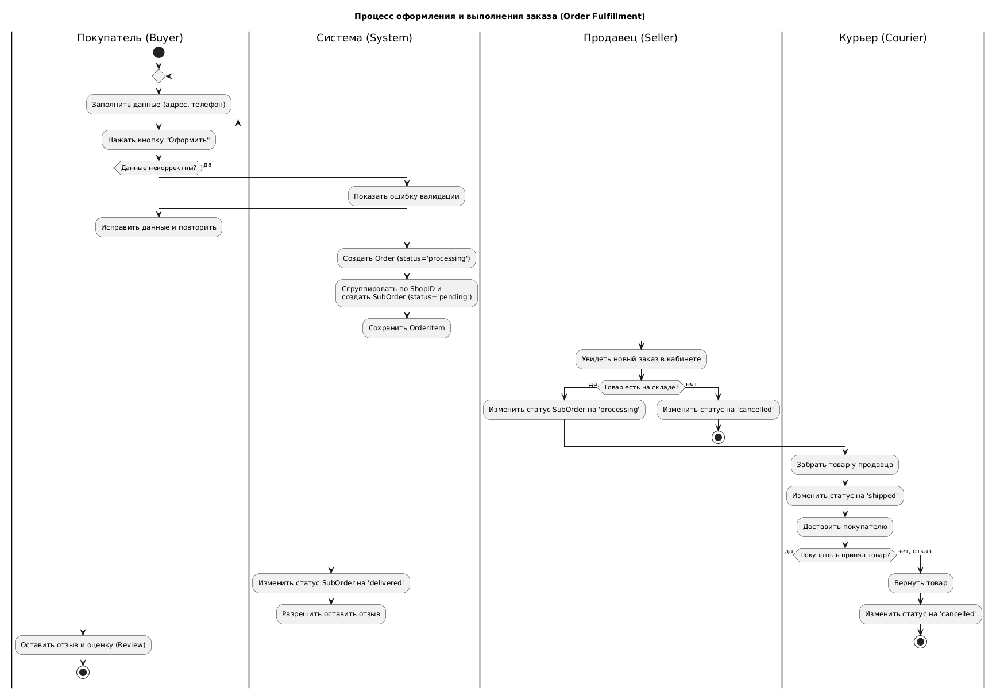
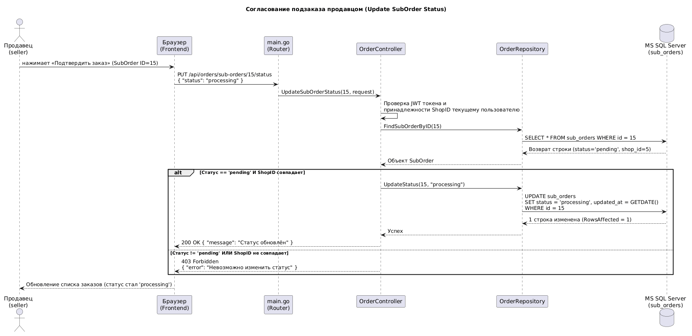
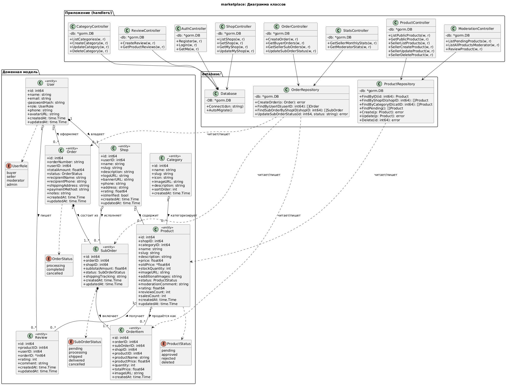
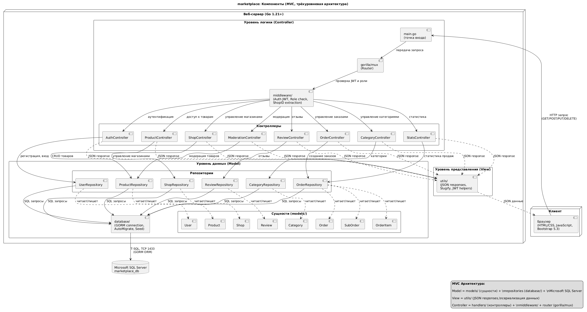
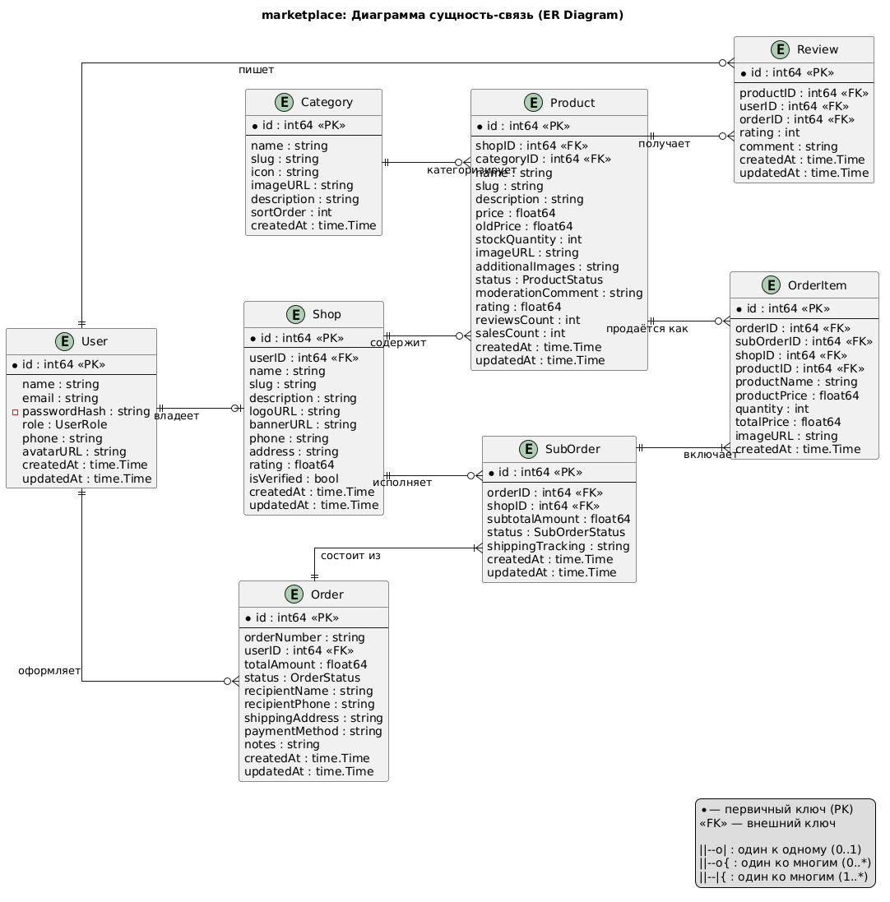
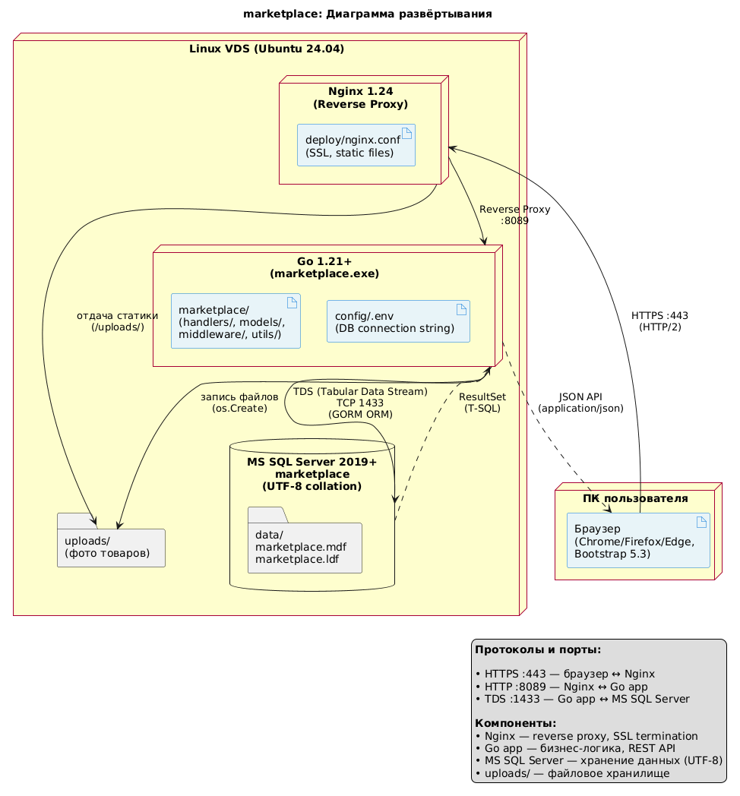

# Супориши техникии пурра барои коркарди низоми иттилоотии маркетплейси молҳо дар Тоҷикистон «marketplace»

Версияи 1.0 · 15.11.2026 · Барномасоз: Наврӯзов Шаҳзод, гурӯҳи барномасозӣ · Фармоишгар: соҳибкорони маҳаллии Тоҷикистон (шартан)

## 1. Маълумоти умумӣ

**Номи пурраи система:** Низоми иттилоотии маркетплейси молҳо дар Тоҷикистон «marketplace».

**Номи кӯтоҳ:** marketplace.

**Фармоишгар:** соҳибкорони хурд ва миёнаи Тоҷикистон, ки молҳои худро тавассути Instagram, Telegram ва Somon.tj мефурӯшанд.

**Иҷрокунанда:** донишҷӯи Донишгоҳи техникии Тоҷикистон ба номи М.С. Осимӣ, кафедраи барномасозӣ ва низомҳои иттилоотӣ.

**Мӯҳлати иҷро:** як семестри таҳсил (сентябр – декабри 2026).

**Асоси коркард:** супориши таълимии кафедраи барномасозӣ ва низомҳои иттилоотӣ, таҳлили бозори тиҷорати электронии Тоҷикистон.

**Ҳуҷҷатҳои асосӣ:** ГОСТ 34.602-89 «Техническое задание на создание автоматизированной системы», супориши техникии кӯтоҳ (лабораторияи 3), таҳлили соҳаи предметӣ (лабораторияи 1).

## 2. Таъинот ва мақсадҳои эҷоди система

Система барои автоматизатсияи раванди хариду фурӯши молҳо дар Тоҷикистон эҷод мешавад. Ҳадафи асосӣ — муттаҳид кардани фурӯшандагони мустақил зери як бренд, таъмини амнияти муомилот (escrow), ташкили логистикаи шаффоф ва пешниҳоди таҷрибаи ягонаи харид барои истифодабарандагон.

**Мушкилоти ҳалшаванда:**
- Набудани сабади ягона ва муомилоти бехатар: харидорон маблағро мустақиман ба фурӯшанда мегузаронанд, ки хатари қаллобиро зиёд мекунад.
- Логистикаи номуназзам: расонидан ба минтақаҳо ғайримуташаккил аст, трек-номер ва пайгирии вазъият вуҷуд надорад.
- Такроршавии додаҳо: фурӯшандагон бақияро дар Excel нигоҳ медоранд, ки боиси фурӯши молҳои мавҷуднабуда мегардад.

**Мақсадҳои ченшаванда:**
- Вақти расонидан дар Душанбе то 1–3 рӯз, дар минтақаҳо то 3–7 рӯз.
- Кам кардани ҳолатҳои қаллобӣ то 90% нисбат ба тиҷорат дар Instagram.
- Дастгирии пурраи забонҳои тоҷикӣ ва русӣ (UTF-8).
- Вақти боркунии саҳифаи каталог бо 100 мол на зиёда аз 1.5 сония.

## 3. Тавсифи объекти автоматикунонӣ

Объекти автоматикунонӣ — бозори тиҷорати электронии Тоҷикистон, ки ҳоло тавассути Instagram, Telegram-каналҳо ва Somon.tj амал мекунад. Ин усулҳо хусусиятҳои зерин доранд:

- **Somon.tj** — доскаи эълонҳо (классифайд), на маркетплейс: сабади ягона, муомилоти бехатар ва логистикаи марказонидашуда вуҷуд надорад.
- **Instagram/Telegram** — канали ғайрирасмии тиҷорат: каталоги ягона, муқоисаи нархҳо ва кафолатҳо нестанд.
- **Ozon, Wildberries, AliExpress** — маркетплейсҳои байналмилалӣ, ки расонидан ба Тоҷикистон тӯлонӣ (2–4 ҳафта) ва гарон аст.

**Акторони система** (аз таҳлили соҳаи предметӣ):
| Нақш | Код | Кӣ аст |
|---|---|---|
| Харидор | buyer | Шахси воқеӣ, ки мол мехарад |
| Фурӯшанда | seller | ИП ё ширкат, ки мол мефурӯшад |
| Курйер | courier | Корманди хизмати расонидан |
| Модератор | moderator | Корманди дастгирии маркетплейс |
| Администратор | admin | Соҳиби платформа |

**Равандҳои асосии бизнес:**
1. Бақайдгирӣ ва тасдиқи фурӯшанда.
2. Иловаи мол ба каталог ва модератсия.
3. Расмӣ кардан ва иҷрои фармоиш.
4. Баргардонидани мол.

## 4. Талабот ба система

### 4.1. Талабот ба система дар маҷмӯъ

**Талабот ба боэътимодӣ:**
- Нусхаи эҳтиётии пойгоҳи додаҳо ҳар рӯз.
- Вақти кори система на камтар аз 99% дар моҳ.

**Талабот ба амният:**
- Паролҳо танҳо дар шакли хеш (bcrypt) нигоҳ дошта мешаванд.
- Ҳифоз аз SQL-инъексия ва XSS тавассути запросҳои параметрӣ ва экраниронии баромад.
- Ҷудокунии ҳуқуқҳо аз рӯи нақшҳо (buyer, seller, moderator, admin).

**Талабот ба ҳайати кормандон:**
- Дар марҳилаи MVP система тавассути як барномасоз ва як модератор идора мешавад.

### 4.2. Талабот ба функсияҳо

Ҳамаи талабот бо усули MoSCoW тасниф карда шудаанд:

| ID | Талабот | Нақш | MoSCoW |
|---|---|---|---|
| ФТ-01 | Бақайдгирӣ, аутентификатсия ва ҷудокунии ҳуқуқҳо аз рӯи нақшҳо | ҳама | Must |
| ФТ-02 | Эҷод, дидан ва таҳрири корти мол (ном, тавсиф, нарх, расм то 2 МБ) | seller | Must |
| ФТ-03 | Модератсияи кортҳои нави мол: тасдиқ ё рад бо сабаб | moderator | Must |
| ФТ-04 | Ҷустуҷӯи мол аз рӯи ном ва филтр аз рӯи категория ва нарх бо пагинация | buyer | Must |
| ФТ-05 | Иловаи мол аз фурӯшандагони гуногун ба сабади ягона | buyer | Must |
| ФТ-06 | Расмӣ кардани фармоиш бо суроға ва интихоби пардохти нақд ҳангоми гирифтан | buyer | Must |
| ФТ-07 | Тасдиқи мавҷудияти мол аз ҷониби фурӯшанда ва гузариш ба вазъияти «омода ба интиқол» | seller | Must |
| ФТ-08 | Иваз кардани вазъияти фармоиш ба «дар роҳ» ва «расонида шуд» бо сабти вақт | courier | Must |
| ФТ-09 | Гузоштани шарҳи матнӣ ва баҳо (1–5 ситора) ба мол пас аз расонидан | buyer | Should |
| ФТ-10 | Идоракунии каталоги категорияҳо ва минтақаҳои расонидан | admin | Should |
| ФТ-11 | Экспорти ҳисоботи фурӯш дар муддати муайян ба формати CSV | seller | Could |
| ФТ-12 | Интегратсия бо шлюзҳои пардохти берунӣ барои пардохти онлайн | система | Won't |

**Матрисаи дастрасӣ «нақш × функсия»:**

| Функсия | buyer | seller | courier | moderator | admin |
|---|---|---|---|---|---|
| ФТ-01 Аутентификатсия | ҳа | ҳа | ҳа | ҳа | ҳа |
| ФТ-02 Корти мол | дидан | эҷод/таҳрир | дидан | дидан | дидан |
| ФТ-03 Модератсия | — | — | — | ҳа | — |
| ФТ-04 Ҷустуҷӯ | ҳа | — | — | — | — |
| ФТ-05 Сабад | ҳа | — | — | — | — |
| ФТ-06 Расмӣ кардан | ҳа | — | — | — | — |
| ФТ-07 Тасдиқи мол | — | ҳа | — | — | — |
| ФТ-08 Вазъияти расонидан | дидан | дидан | ҳа | — | — |
| ФТ-09 Шарҳ | ҳа | дидан | — | — | — |
| ФТ-10 Категорияҳо | дидан | — | — | — | ҳа |
| ФТ-11 Экспорти CSV | — | ҳа | — | — | — |

### 4.3. Талабот ба намудҳои таъминот

**Таъминоти иттилоотӣ:** Пойгоҳи додаҳои marketplace, 8 ҷадвал, 3НФ, collation Latin1_General_100_CI_AS_SC_UTF8 (ниг. бахши 5.4).

**Таъминоти барномавӣ:** Go 1.21+, MS SQL Server 2019+, GORM (ORM), gorilla/mux (router), Bootstrap 5.3 (фронтенд), bcrypt (хеши парол). Сервери веб: Nginx + reverse proxy.

**Таъминоти техникӣ:** VDS 1 vCPU, 1 ГБ RAM, 10 ГБ SSD, Ubuntu 24.04 (ниг. диаграммаи ҷойгиркунӣ).

**Таъминоти лингвистӣ:** Интерфейс бо забонҳои тоҷикӣ ва русӣ; ворид ва хуруҷи додаҳо бо ҳуруфи кириллӣ бе таҳриф (UTF-8).

## 5. Моделҳои система

### 5.1. Диаграммаи вариантҳои истифода

Расми 1. Панҷ нақш (buyer, seller, courier, moderator, admin) ва 11 варианти истифода; ба ҳар талаби Must як вариант мувофиқ аст. Муносибатҳои <<include>> ва <<extend>> истифода шудаанд.

### 5.2. Раванди «Расмӣ кардан ва иҷрои фармоиш»

Расми 2. Раванди расмӣ кардан ва иҷрои фармоиш бо чор роҳ (харидор, система, фурӯшанда, курйер), ду шохаи if ва як даври repeat.

Расми 3. Мувофиқати зерифармоиш аз ҷониби фурӯшанда: браузер → Router → OrderController → OrderRepository → MS SQL Server. Блоки alt ду шохаи иҷроро нишон медиҳад.

### 5.3. Сохтори система

Расми 4. Ҳашт синфи домении (User, Shop, Category, Product, Order, SubOrder, OrderItem, Review), чор enum ва синфҳои барномавӣ (контроллерҳо ва репозиторийҳо).

Расми 5. Меъмории сесатҳа (Presentation, Application, Data Access) ва қолаби MVC.

### 5.4. Додаҳо ва ҷойгиркунӣ

Расми 6. Модели мантиқии пойгоҳи додаҳо бо 8 ҷадвал, PK/FK, нотатсияи Crow's Foot.

Расми 7. Меъмории физикӣ: браузер → Nginx (HTTPS:443) → Go app (HTTP:8089) → MS SQL Server (TDS:1433).

## 6. Таркиб ва мундариҷаи корҳо

| Марҳила | Корҳо | Натиҷа | Мӯҳлат |
|---|---|---|---|
| 1. Лоиҳакашӣ (Р-1) | Таҳлил, СТ, моделҳо, ПД | 08-technical-specification.md, schema.sql | Рӯзи 8 |
| 2. Дизайн | UX/UI дар Figma, прототип | Макетҳои саҳифаҳо | Рӯзи 9 |
| 3. Frontend | Тарҳбандӣ, Bootstrap 5.3, JS | Саҳифаҳои статикӣ | Рӯзҳои 10–11 |
| 4. Backend | Go, ПД, аутентификатсия, REST API | MVP-и коркунанда | Рӯзҳои 12–14 |
| 5. Санҷиш | Тест-кейсҳо, санҷиши дастӣ | 15-test-cases.md | Рӯзи 15 |
| 6. Нашр | VDS, HTTPS, мониторинг | Система дар интернет | Рӯзи 16 (Р-2) |

## 7. Тартиби назорат ва қабул

**Меъёри қабул:** Система қабулшуда ҳисобида мешавад, агар 100% талаботи Must иҷро шуда бошад ва хатоҳои дорои афзалияти «критикӣ» набошанд.

**Тартиби озмоишҳо:**
1. Иҷрои `database/schema.sql` ва `database/seed.sql` дар пойгоҳи додаҳои тоза — бояд бе хато иҷро шаванд.
2. Санҷиши ҳамаи user story-ҳои Must бо логинҳои санҷишӣ (buyer@market.tj, seller1@market.tj, moderator@market.tj, admin@market.tj, парол 123456).
3. Иҷрои ҳамаи 6 запроси `database/queries.sql` ва муқоисаи натиҷа бо натиҷаи интизоршуда.
4. Санҷиши НФТ-01: вақти боркунии саҳифаи каталог бо 100 мол на зиёда аз 1.5 сония (DevTools → Network, Throttling: Fast 3G).
5. Санҷиши НФТ-03: ворид кардани матни тоҷикӣ (масалан, «Хуҷанд») ва хондани он аз пойгоҳи додаҳо бе таҳриф.
6. Санҷиши НФТ-05: кӯшиши SQL-инъексия дар формаи ҷустуҷӯ — бояд бехатар кор кунад.

## 8. Талабот ба ҳуҷҷатгузорӣ

Система бояд ҳуҷҷатҳои зеринро дошта бошад:
- **README.md** — дастури оғоз ва истифодабарӣ.
- **docs/08-technical-specification.md** — супориши техникии пурра (ҳамин ҳуҷҷат).
- **docs/01-domain-analysis.md** — таҳлили соҳаи предметӣ.
- **docs/02-comparison-matrix.md** — матритсаи муқоисавии аналогҳо.
- **docs/03-short-spec.md** — супориши техникии кӯтоҳ.
- **database/schema.sql, seed.sql, queries.sql** — скриптҳои пойгоҳи додаҳо.
- **16-deploy.md** — дастури насб дар VDS.
- **15-test-cases.md** — тест-кейсҳо.

## 9. Манбаъҳои коркард

**Адабиёт:**
1. ГОСТ 34.602-89 «Техническое задание на создание автоматизированной системы».
2. Документатсияи Go: https://golang.org/doc/
3. Документатсияи GORM: https://gorm.io/docs/
4. Документатсияи MS SQL Server: https://docs.microsoft.com/sql/
5. Лексияҳои фанни «Технологияҳо ва забонҳои интернет-барномасозӣ», ДПДТТХ, 2026.

**Ҳуҷҷатҳои меъёрӣ:**
- Қонуни Ҷумҳурии Тоҷикистон «Дар бораи тиҷорати электронӣ».
- Стандартҳои амнияти OWASP Top 10.